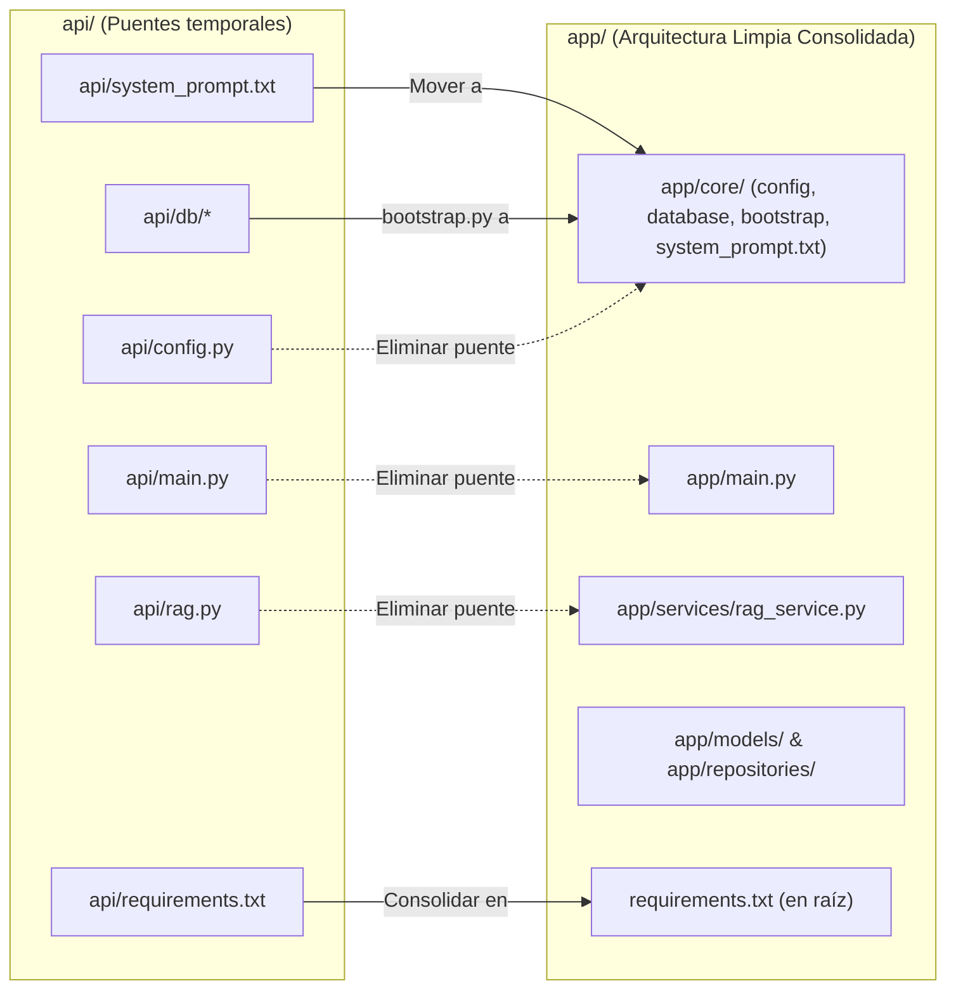

# Plan de Eliminación de `api/` y Consolidación en `app/`

## Objetivo

Explicar la razón de la existencia temporal de [`api/`](file:///home/jhobadev/Escritorio/Dev/reto-kodo-takai/backend-translogix/api) y definir el plan para su **eliminación definitiva**, migrando las referencias residuales en scripts y documentación directamente a [`app/`](file:///home/jhobadev/Escritorio/Dev/reto-kodo-takai/backend-translogix/app).

---

## Contexto: ¿Por qué se mantuvo la carpeta `api/`?

La carpeta [`api/`](file:///home/jhobadev/Escritorio/Dev/reto-kodo-takai/backend-translogix/api) no contiene lógica de negocio duplicada: actualmente contiene **módulos puente (fachadas de retrocompatibilidad)** que reexportan desde [`app/`](file:///home/jhobadev/Escritorio/Dev/reto-kodo-takai/backend-translogix/app).

Se mantuvo temporalmente para implementar una **migración de cero tiempo de inactividad (Zero-Downtime Migration)**:
1. Permitió que scripts externos como [`scripts/check_schema.py`](file:///home/jhobadev/Escritorio/Dev/reto-kodo-takai/backend-translogix/scripts/check_schema.py) y [`scripts/rubric_check.py`](file:///home/jhobadev/Escritorio/Dev/reto-kodo-takai/backend-translogix/scripts/rubric_check.py) continuaran pasando sin romperse durante la fase inicial de refactorización.
2. Evitaba romper el CLI de desarrollo preexistente [`scripts/dev.py`](file:///home/jhobadev/Escritorio/Dev/reto-kodo-takai/backend-translogix/scripts/dev.py).

Habiendo concluido y verificado la arquitectura [`app/`](file:///home/jhobadev/Escritorio/Dev/reto-kodo-takai/backend-translogix/app) y la suite de pruebas automatizadas con `pytest` (70 pruebas pasando), **la carpeta `api/` ya cumplió su propósito de transición y es momento de removerla por completo**.

---

## Revisión del Usuario Requerida

> [!IMPORTANT]
> **Reubicación de Recursos Activos**:
> Dentro de `api/` aún existen 3 recursos no duplicados que deben ser reubicados antes de borrar la carpeta:
> 1. `api/system_prompt.txt` → Se moverá a [`app/core/system_prompt.txt`](file:///home/jhobadev/Escritorio/Dev/reto-kodo-takai/backend-translogix/app/core/system_prompt.txt).
> 2. `api/db/bootstrap.py` → Se moverá a [`app/core/bootstrap.py`](file:///home/jhobadev/Escritorio/Dev/reto-kodo-takai/backend-translogix/app/core/bootstrap.py).
> 3. `api/requirements.txt` → Se consolidará en la raíz del proyecto como `requirements.txt`.
>
> **Actualización de Scripts**:
> Se actualizarán [`scripts/check_schema.py`](file:///home/jhobadev/Escritorio/Dev/reto-kodo-takai/backend-translogix/scripts/check_schema.py), [`scripts/rubric_check.py`](file:///home/jhobadev/Escritorio/Dev/reto-kodo-takai/backend-translogix/scripts/rubric_check.py) y [`scripts/dev.py`](file:///home/jhobadev/Escritorio/Dev/reto-kodo-takai/backend-translogix/scripts/dev.py) para que importen directamente de `app.*`.

---

## Preguntas Abiertas

> [!NOTE]
> Ninguna bloqueante. ¿Deseas proceder con la eliminación completa de `api/` y la actualización directa de todos los scripts y documentación a `app`?

---

## Cambios Propuestos



---

### 1. Reubicación de Recursos Activos

#### [NEW] `app/core/system_prompt.txt`
- Mover el contenido de `api/system_prompt.txt` a `app/core/system_prompt.txt`.

#### [NEW] `app/core/bootstrap.py`
- Mover la lógica de inicialización y migración DDL desde `api/db/bootstrap.py` a `app/core/bootstrap.py`.
- Actualizar sus importaciones:
  ```python
  from app.core import config
  from app.models.pqrsd import Base
  ```

#### [NEW] `requirements.txt`
- Consolidar las dependencias de `api/requirements.txt` en la raíz del repositorio (`requirements.txt`).

---

### 2. Actualización de Servicios para el Nuevo Prompt

#### [MODIFY] [`app/services/rag_service.py`](file:///home/jhobadev/Escritorio/Dev/reto-kodo-takai/backend-translogix/app/services/rag_service.py)
- Actualizar `PROMPT_PATH` para que apunte por defecto a `app/core/system_prompt.txt`:
  ```python
  PROMPT_PATH = Path(__file__).resolve().parent.parent / "core" / "system_prompt.txt"
  ```

---

### 3. Migración de Scripts a `app.*`

#### [MODIFY] [`scripts/check_schema.py`](file:///home/jhobadev/Escritorio/Dev/reto-kodo-takai/backend-translogix/scripts/check_schema.py)
- Reemplazar importaciones de `api.db.*`:
  ```python
  # De:
  from api.db.models import Base
  from api.db.schemas import ...
  from api.db.plazos import add_business_days
  # A:
  from app.models.pqrsd import Base
  from app.schemas.pqrsd import ...
  from app.domain.plazos import add_business_days
  ```

#### [MODIFY] [`scripts/rubric_check.py`](file:///home/jhobadev/Escritorio/Dev/reto-kodo-takai/backend-translogix/scripts/rubric_check.py)
- Reemplazar importaciones de `api.*`:
  ```python
  from app.core import config
  from app.infrastructure.ollama import OllamaEmbedder
  from app.services.ingest_service import _knowledge_base_files
  from app.domain.plazos import add_business_days
  from app.schemas.pqrsd import ...
  from app.schemas.rag import AskRequest
  from app.models.pqrsd import Base
  from app.main import app
  from app.services.rag_service import LocalVectorRAG
  ```

#### [MODIFY] [`scripts/dev.py`](file:///home/jhobadev/Escritorio/Dev/reto-kodo-takai/backend-translogix/scripts/dev.py)
- Cambiar `REQUIREMENTS = REPO_ROOT / "requirements.txt"`.
- En `_ingest`: comando `[sys.executable, "-m", "app.services.ingest_service"]`.
- En `_api`: comando `[sys.executable, "-m", "uvicorn", "app.main:app", ...]`.
- En `_check`: `for relative in ("app", "scripts"):` (eliminando compilación de `api/`).
- En `_db_init`: importar `from app.core import bootstrap`, `from app.core import database as db`.

---

### 4. Eliminación de la Carpeta `api/`

#### [DELETE] Directorio `api/` completo
- `api/config.py`
- `api/main.py`
- `api/rag.py`
- `api/embeddings.py`
- `api/lexical.py`
- `api/ingest.py`
- `api/system_prompt.txt`
- `api/requirements.txt`
- `api/db/` (todos sus subarchivos)

---

### 5. Actualización de Documentación

#### [MODIFY] [`README.md`](file:///home/jhobadev/Escritorio/Dev/reto-kodo-takai/backend-translogix/README.md) y [`AGENTS.md`](file:///home/jhobadev/Escritorio/Dev/reto-kodo-takai/backend-translogix/AGENTS.md)
- Actualizar mapa del repositorio sustituyendo `api/` por `app/`.
- Actualizar rutas de comandos CLI (`python -m app.services.ingest_service`).
- Actualizar ubicación de `system_prompt.txt` (`app/core/system_prompt.txt`).

---

## Plan de Verificación

### Pruebas Automatizadas
1. **Suite Pytest**:
   ```bash
   .venv/bin/python3 -m pytest tests/ -v
   ```
   *Debe mantener los 70 tests pasando al 100%.*

2. **Verificación de Tipos y Compilación**:
   ```bash
   .venv/bin/python3 scripts/dev.py check
   ```
   *Debe compilar `app/` y `scripts/` limpiamente sin buscar `api/`.*

3. **Guardia de Esquemas**:
   ```bash
   .venv/bin/python3 scripts/check_schema.py
   ```
   *Debe confirmar las 28 tablas e integridad de esquemas importando desde `app.*`.*

4. **Banco de Rúbrica KODO TAKAI**:
   ```bash
   .venv/bin/python3 scripts/rubric_check.py
   ```
   *Debe ejecutar todos los criterios evaluando directamente sobre `app.*` sin advertencias C3.2.*

### Verificación Manual
1. Iniciar el servidor mediante el script de desarrollo:
   ```bash
   .venv/bin/python3 scripts/dev.py api
   ```
2. Ejecutar el smoke test en otra terminal:
   ```bash
   .venv/bin/python3 scripts/dev.py smoke
   ```
