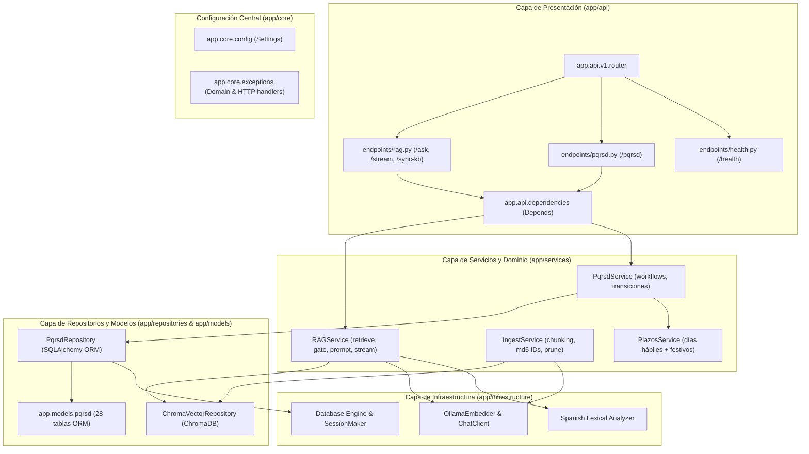

# Plan de Refactorización Arquitectónica y Buenas Prácticas

## Objetivo

Reestructurar y profesionalizar el código del servicio `asistencia-cliente-local` migrando de una estructura plana y acoplada dentro de `api/` hacia una **Arquitectura en Capas / Clean Architecture** (`app/`), incorporando los patrones de producción definidos en las skills de [`.agents/skills`](file:///home/jhobadev/Escritorio/Dev/reto-kodo-takai/backend-translogix/.agents/skills):

1. **`fastapi-templates`**: Separación estricta entre capa de presentación (`app/api`), configuración (`app/core`), acceso a datos (`app/repositories`, `app/models`), esquemas (`app/schemas`) y lógica de negocio (`app/services`), con Inyección de Dependencias (`Depends`) en lugar de acoplamiento directo a `request.app.state`.
2. **`pydantic`**: Esquemas de entrada y salida con validación estricta (`extra="forbid"`, resolviendo la advertencia C3.2 de la rúbrica), uso de `Annotated`, tipos semánticos y `str_strip_whitespace=True`.
3. **`python-testing-patterns`**: Creación de una suite de pruebas estructurada con `pytest` (`tests/unit` e `tests/integration`), fixtures reutilizables (`conftest.py`), mocks de hardware/Ollama y pruebas de contratos.
4. **`rag-implementation`**: Desacoplamiento de componentes RAG (Embedder, Vector Store, Gate léxico híbrido y Generador/Streamer), respetando los límites de hardware CPU local (7.2 GB RAM, concurrencia 1).
5. **Compatibilidad total (Zero-Downtime Migration)**: Creación de la rama `feat/refactor-architecture-and-structure`, manteniendo fachadas de compatibilidad en `api/` para que `scripts/dev.py`, `scripts/rubric_check.py` y `scripts/check_schema.py` continúen funcionando sin fricción.

---

## Revisión del Usuario Requerida

> [!IMPORTANT]
> **Creación de nueva rama**: Todo el trabajo se ejecutará en la rama `feat/refactor-architecture-and-structure` partiendo del estado actual de `main`.
>
> **Preservación del hardware budget**: Se mantienen inalterables las restricciones críticas de `AGENTS.md` (concurrencia de LLM a 1, embeddings locales por lotes de 32, timeouts holgados para CPU y string de rechazo exacto: `No tengo esa información en mi base local`).
>
> **Capa de compatibilidad reversa**: Para no romper ningún script existente (`dev.py`, `rubric_check.py`, `check_schema.py`), `api/` mantendrá módulos puente que reexportan desde `app/`.

---

## Preguntas Abiertas

> [!NOTE]
> Ninguna bloqueante. Se propone `feat/refactor-architecture-and-structure` como nombre estándar para la nueva rama.

---

## Arquitectura Propuesta



---

## Cambios Propuestos por Componente

### 1. Nueva Estructura del Proyecto

```text
backend-translogix/
├── app/
│   ├── __init__.py
│   ├── main.py                     # [NEW] FastAPI factory, lifespan, middlewares
│   ├── api/
│   │   ├── __init__.py
│   │   ├── dependencies.py         # [NEW] Depends(get_db), Depends(get_rag_service), etc.
│   │   └── v1/
│   │       ├── __init__.py
│   │       ├── router.py           # [NEW] Agrupador de rutas v1
│   │       └── endpoints/
│   │           ├── __init__.py
│   │           ├── health.py       # [NEW] GET /health (liveness probe)
│   │           ├── rag.py          # [NEW] POST /ask, /ask/stream, /sync-kb
│   │           └── pqrsd.py        # [NEW] CRUD PQRSD y anexos
│   ├── core/
│   │   ├── __init__.py
│   │   ├── config.py               # [NEW] Settings centralizadas
│   │   ├── database.py             # [NEW] Engine, SessionLocal, get_db
│   │   └── exceptions.py           # [NEW] Manejadores de excepción globales (DB, Ollama, Domain)
│   ├── domain/
│   │   ├── __init__.py
│   │   ├── exceptions.py           # [NEW] Excepciones de dominio (NotFound, Conflict, etc.)
│   │   └── plazos.py               # [NEW] Lógica de días hábiles y festivos colombianos
│   ├── models/
│   │   ├── __init__.py
│   │   └── pqrsd.py                # [NEW] Modelos SQLAlchemy (28 tablas y Base)
│   ├── schemas/
│   │   ├── __init__.py
│   │   ├── base.py                 # [NEW] Schema base con extra='forbid' y strip_whitespace
│   │   ├── rag.py                  # [NEW] AskRequest, AskResponse, SourceModel
│   │   ├── pqrsd.py                # [NEW] Schemas de PQRSD y validaciones
│   │   └── catalogs.py             # [NEW] Schemas de catálogos
│   ├── repositories/
│   │   ├── __init__.py
│   │   ├── pqrsd_repository.py     # [NEW] Acceso a PostgreSQL
│   │   └── vector_repository.py    # [NEW] Abstracción de ChromaDB
│   ├── services/
│   │   ├── __init__.py
│   │   ├── rag_service.py          # [NEW] Orquestación RAG, prompt y streaming
│   │   ├── ingest_service.py       # [NEW] Pipeline de ingestión y chunking
│   │   └── pqrsd_service.py        # [NEW] Orquestación de casos PQRSD
│   └── infrastructure/
│       ├── __init__.py
│       ├── ollama.py               # [NEW] OllamaEmbedder y clientes async/sync
│       └── lexical.py              # [NEW] Análisis léxico en español para gate híbrido
├── api/                            # Capa de compatibilidad retrocompatible
│   ├── __init__.py
│   ├── main.py                     # [MODIFY] Reexporta app desde app.main
│   ├── config.py                   # [MODIFY] Reexporta config desde app.core.config
│   ├── rag.py                      # [MODIFY] Reexporta LocalVectorRAG desde app.services.rag_service
│   ├── embeddings.py               # [MODIFY] Reexporta OllamaEmbedder desde app.infrastructure.ollama
│   ├── lexical.py                  # [MODIFY] Reexporta lexical_evidence desde app.infrastructure.lexical
│   ├── ingest.py                   # [MODIFY] Reexporta ingest functions y CLI desde app.services.ingest_service
│   └── db/
│       ├── __init__.py
│       ├── models.py               # [MODIFY] Reexporta Base y modelos desde app.models.pqrsd
│       ├── schemas.py              # [MODIFY] Reexporta schemas desde app.schemas
│       ├── plazos.py               # [MODIFY] Reexporta plazos desde app.domain.plazos
│       ├── repository.py           # [MODIFY] Reexporta repository desde app.repositories.pqrsd_repository
│       ├── session.py              # [MODIFY] Reexporta get_db desde app.core.database
│       ├── engine.py               # [MODIFY] Reexporta engine desde app.core.database
│       └── router.py               # [MODIFY] Reexporta router desde app.api.v1.endpoints.pqrsd
├── tests/                          # [NEW] Suite de pruebas automatizadas
│   ├── __init__.py
│   ├── conftest.py                 # [NEW] Fixtures de pytest, TestClient, mocks de Ollama y DB
│   ├── unit/
│   │   ├── __init__.py
│   │   ├── test_schemas.py         # [NEW] Validación Pydantic y extra='forbid'
│   │   ├── test_lexical.py         # [NEW] Gate de evidencia léxica en español
│   │   ├── test_plazos.py          # [NEW] Cálculo de plazos y días festivos
│   │   └── test_chunking.py        # [NEW] Lógica de chunking markdown/pdf
│   └── integration/
│       ├── __init__.py
│       ├── test_health.py          # [NEW] Verificación de /health
│       ├── test_rag_api.py         # [NEW] Contratos de /api/v1/ask y streaming
│       └── test_pqrsd_api.py       # [NEW] Contratos de /api/v1/pqrsd y degradación 503
└── scripts/
    ├── dev.py                      # [MODIFY] Soporte directo para app.main:app
    └── check_schema.py             # Verificación de integridad garantizada
```

---

### 2. Detalle de Mejoras Clave

#### A. Inyección de Dependencias Limpia (`app/api/dependencies.py`)
En lugar de depender de `request.app.state.rag`:
```python
def get_rag_service(request: Request) -> RAGService:
    return request.app.state.rag_service

def get_semaphore(request: Request) -> asyncio.Semaphore:
    return request.app.state.semaphore
```
Permite sobreescribir dependencias en pruebas unitarias mediante `app.dependency_overrides`.

#### B. Validación Estricta con Pydantic (`app/schemas/base.py` y `app/schemas/rag.py`)
Resolviendo la advertencia C3.2 de la rúbrica:
```python
class AppBaseModel(BaseModel):
    model_config = ConfigDict(
        extra="forbid",
        str_strip_whitespace=True,
    )

class AskRequest(AppBaseModel):
    question: Annotated[str, StringConstraints(min_length=1, max_length=2000)]
    categoria: str | None = None
```

#### C. Suite de Pruebas Pytest (`tests/`)
Implementación de pruebas unitarias e integración que no dependan obligatoriamente de PostgreSQL ni de una GPU externa, permitiendo verificar el sistema en milisegundos mediante mocks y SQLite en memoria.

---

## Plan de Verificación

### Pruebas Automatizadas
1. **Verificación de Tipos y Compilación**:
   ```bash
   python3 scripts/dev.py check
   ```
2. **Suite de Pruebas Pytest**:
   ```bash
   .venv/bin/pytest tests/ -v
   ```
3. **Guardia de Esquemas SQL vs Modelos**:
   ```bash
   python3 scripts/check_schema.py
   ```
4. **Banco de Pruebas de la Rúbrica KODO TAKAI**:
   ```bash
   python3 scripts/rubric_check.py
   ```
   *Se verificará que la advertencia C3.2 (`AskRequest no declara extra='forbid'`) quede subsanada.*

### Verificación Manual
1. Iniciar el servidor mediante el script de desarrollo:
   ```bash
   python3 scripts/dev.py api
   ```
2. Ejecutar el smoke test contra la API activa:
   ```bash
   python3 scripts/dev.py smoke
   ```
